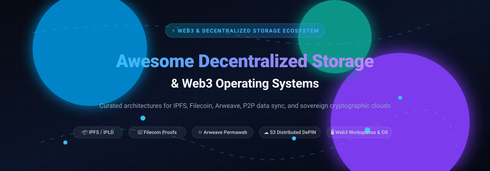

# Awesome-Decentralized-Storage-WEB3-Operating-System

  

 

### 🌐 Curated List of Decentralized Storage Protocols, Web3 Cloud Platforms, & P2P Operating Systems

*Empowering developers with Content-Addressed Storage (IPFS/IPLD), Permanent Blockchain Archives, S3-Compatible DePIN Clouds, and Sovereign Cryptographic Desktop Environments.*

**Last updated: November 2026**

---

## 📖 Table of Contents

- [🌟 Introduction & Ecosystem Scope](#-introduction--ecosystem-scope)
- [📊 Sector Overview & Market Dynamics](#-sector-overview--market-dynamics)
- [☁️ SaaS/Hosted Platforms](#️-saashosted-platforms)
- [💻 Open-Source GitHub Projects](#-open-source-github-projects)
- [🛠️ Key Architectural Frameworks](#️-key-architectural-frameworks)
- [🤝 How to Contribute](#-how-to-contribute)
- [💖 Support & Share](#-support--share)
- [📈 Star History](#-star-history)
- [⚠️ Disclaimer](#️-disclaimer)

---

## 🌟 Introduction & Ecosystem Scope

This repository tracks notable **SaaS/hosted platforms** and **open-source software** powering **Decentralized Storage & Web3 Operating Systems**. These systems store, pin, replicate, encrypt, mount, and serve content-addressed datasets, permanent permaweb archives, decentralized web applications, and sovereign Web3 desktop environments across peer-to-peer storage networks, cryptographic storage markets, and self-hosted clustered nodes.

### 🎯 Key Architectural Pillars
- **Content-Addressed Storage (CAS):** Hash-based immutable storage primitives (`IPFS`, `IPLD`, `Iroh`).
- **Verifiable Storage Markets & Smart Contracts:** Cryptographic proofs of replication and spacetime (`Filecoin`, `Crust Network`).
- **Permanent Blockchain Data Endowments:** Pay-once-store-forever immutable permaweb vaults (`Arweave`, `ArDrive`, `Akord`).
- **Distributed Cloud & S3 Gateways:** Geo-distributed, client-side encrypted object storage (`Storj`, `Filebase`, `SeaweedFS`, `Garage`, `Ceph`).
- **Web3 Operating Systems & Workspaces:** P2P file systems, identity stacks, and cryptographic app runtimes (`metrox-eth/moss`, `Peergos`, `Urbit`).

---

## 📊 Sector Overview & Market Dynamics

The global decentralized storage and Web3 data infrastructure sector is estimated at **$1.2B to $2.0B**, expanding at a rapid compound annual growth rate (CAGR) of **~22% to 26%** and projected to exceed **$8B+ by 2033**, propelled by enterprise demand for tamper-proof audit trails, resilient DePIN economics, sovereign AI dataset hosting, and alternatives to centralized cloud egress costs.

In terms of structure, the sector exhibits **bifurcated market dynamics**: while the underlying physical storage capacity is **highly fragmented** across tens of thousands of independent global nodes and miners, the commercial and protocol layer is **moderately concentrated** among leading network protocols (**Protocol Labs / Filecoin**, **Arweave**, and **Storj**) and dominant developer gateways (**Consensys Infura**, **QuickNode**, and **Pinata**) that capture majority market mindshare and enterprise integrations.

---

## ☁️ SaaS/Hosted Platforms

A curated comparison of leading managed Web3 storage gateways, pinning providers, and developer cloud APIs, sorted by **company scale (valuation / funding / ARR)** descending.

| Platform | Description | Pricing (Starting Paid Tier) | Free Tier / Trial Limits | Company Scale (Valuation / Revenue / Funding) |
| :--- | :--- | :--- | :--- | :--- |
| **[Infura](https://infura.io)** | Managed enterprise Web3 & IPFS infrastructure suite by Consensys providing high-availability APIs and dedicated content gateways. | $50.00 / month (Developer Tier) | Free forever plan: 3,000,000 credits/day, 500 credits/second rate limit, 1 API key | **$7.0B Valuation** (Consensys Series D; >400k developers) |
| **[QuickNode](https://quicknode.com)** | High-performance multi-chain Web3 cloud infrastructure offering dedicated IPFS nodes, pinning APIs, and edge gateways. | $49.00 / month (Build Tier) | Free forever plan: 10,000,000 API credits/month, 15 req/sec limit, 1 active endpoint | **$800M Valuation** ($106M total funding; >$15M+ ARR) |
| **[Pinata](https://pinata.cloud)** | Managed IPFS pinning service, dedicated content gateways, and Files API enabling developers to upload, serve, and manage media/assets. | $20.00 / month (Picnic Tier) | Free forever plan: 1 GB storage, 500 pinned files, 1 dedicated gateway, 10 GB/month bandwidth, 10k requests/month | **$100M Valuation** ($21.5M funding, ~$8.8M ARR) |
| **[Fleek](https://fleek.xyz)** | Cloud edge deployment and decentralized hosting platform built on IPFS, Filecoin, and Arweave for permissionless web apps, functions, and storage. | $20.00 / month (Pro Tier) | Free forever plan: 500 MB IPFS storage, 100 GB CDN bandwidth, 50,000 API requests, 1M CDN requests/month | **$75M Valuation** ($30M total funding raised) |
| **[ArDrive](https://ardrive.io)** | User-friendly Web3 permanent drive application built on Arweave offering pay-once-store-forever archives and collaborative sharing. | ~$47.63 / GiB one-time permanent storage fee (Turbo Tier) | Free forever plan: Unlimited uploads for individual files under 105 KiB, unlimited free downloads/sharing | **$25M+ Est. Valuation** ($17.2M Seed funding raised) |
| **[Storj](https://storj.io)** | Enterprise S3-compatible decentralized cloud storage platform splitting encrypted, erasure-coded file shards across distributed nodes. | $7.00 / TB / month ($0.007/GB + $0.007/GB egress, $5.00/mo account min) | 30-day free trial: 25 GB decentralized storage, 25 GB egress, 2 Object Mount licenses (no credit card required) | **$5.8M Market Cap / Valuation** ($30M historical ICO & funding) |
| **[Storacha Network (Web3.Storage)](https://storacha.network)** | Decentralized hot-storage and UCAN-authenticated upload platform bridging IPFS content addressing with Filecoin verifiable storage deals. | $5.99 / TB / month (Standard Storage Tier via Fil One) | 30-day free trial: 1 TB decentralized hot storage, free egress & API operations (historical free tier: 5 GB storage) | **$6.5M Total Funding** (Seed led by Protocol Labs PLVS) |
| **[4EVERLAND](https://4everland.org)** | Web3 cloud computing and decentralized storage aggregator unifying IPFS, Arweave, and Dfinity hosting with S3-compatible buckets. | $8.00 / 100 GB / month (IPFS) / $10.00 / 100 GB bandwidth (Pay-as-you-go) | Free forever plan (Decentralized UID): 5 GB/month IPFS storage, 100 MB permanent Arweave storage, 10 GB bandwidth, 250 build mins/month (or 7-day unconditional trial: 1 GB IPFS) | **$3.5M Total Funding** ($1.5M Seed + $2.0M Private Round) |
| **[Filebase](https://filebase.com)** | S3-compatible geo-redundant object storage gateway pinning files automatically across IPFS, Storj, and Sia networks through a single API. | $7.50 / month (Pro Tier) | Free forever plan: 5 GB total storage, 500 pinned files, 1 bucket, 10 GB IPFS bandwidth, 100k Class A & 1M Class B API calls | **$3.5M Total Funding** (Seed led by Multicoin Capital & Version One) |
| **[Akord](https://akord.com)** | Digital vault and permanent storage protocol built on Arweave offering end-to-end encrypted vaults and pay-once-store-forever archives. | ~$9.00 - $33.00 / GB one-time permanent storage fee | Free forever plan: 100 MB - 500 MB permanent blockchain storage with end-to-end encrypted vault access | **$2.3M Total Funding** (Seed led by Maven 11 & D1 Ventures) |
| **[Lighthouse Storage](https://lighthouse.storage)** | Perpetual decentralized file storage service combining IPFS, Filecoin, and Walrus with encryption, token-gated access control, and AI persistent memory. | $12.00 / month (Lite Tier) | Free forever plan: 5 GB IPFS hot storage, 5 GB bandwidth, 100 MB Walrus storage, 10,000 AI memories | **$1.6M Total Funding** (Backed by Protocol Labs, NGC, Walrus Foundation) |
| **[Crust Cloud](https://crust.network)** | Managed Web3 pinning and decentralized storage buckets powered by Crust Network incentive layer and IPFS nodes. | $0.008 / GB / month or via $CRU token staking/DSM orders | Free forever plan (Crust Files & Gateways): Unlimited storage with 40 MB max individual file size limit & public IPFS gateways | **~$130K Market Cap / Valuation** ($4.17M total ICO/token funding raised) |

---

## 💻 Open-Source GitHub Projects

Curated list of open-source decentralized storage protocols, distributed object storage engines, P2P filesystems, and Web3 workspace runtimes. **Sorted in descending order by GitHub_Stars_Count**.

- **[Syncthing](https://github.com/syncthing/syncthing)**   
  Open-source peer-to-peer continuous file synchronization program replacing proprietary sync and cloud services with sovereign, cryptographic device-to-device transfers.

- **[MinIO](https://github.com/minio/minio)**   
  High-performance, Kubernetes-native, S3-compatible decentralized and distributed object storage engine engineered for cloud-native architectures and sovereign private clouds.

- **[SeaweedFS](https://github.com/seaweedfs/seaweedfs)**   
  Fast distributed storage system for blobs, objects, files, and data lakes designed to scale to billions of files with O(1) disk access, S3 API compatibility, and tiering to cloud/Web3 backends.

- **[Ceph](https://github.com/ceph/ceph)**   
  Industry-standard open-source distributed object, block, and file storage platform delivering massive scalability and POSIX/S3 interfaces without single points of failure.

- **[IPFS Kubo](https://github.com/ipfs/kubo)**   
  Flagship open-source Go implementation of the InterPlanetary File System (IPFS) providing content-addressed P2P file distribution, Bitswap block exchange, DHT routing, and HTTP gateways.

- **[Iroh](https://github.com/n0-computer/iroh)**   
  High-throughput, next-generation peer-to-peer data sync and content-addressed blob streaming library written in Rust using QUIC hole punching and BLAKE3 verified streaming.

- **[Nostr Protocol](https://github.com/nostr-protocol/nostr)**   
  Minimalist, censorship-resistant, decentralized communication and sovereign data dissemination protocol utilizing simple cryptographic signatures and distributed relays.

- **[AT Protocol](https://github.com/bluesky-social/atproto)**   
  Social networking and decentralized data protocol created by Bluesky featuring user-controlled cryptographic repositories, federated data hosting, and content-addressed blob storage.

- **[OrbitDB](https://github.com/orbitdb/orbitdb)**   
  Serverless, peer-to-peer database engine written for Web3 applications, built on IPFS for storage and IPLD for data structure synchronization using CRDTs.

- **[anacrolix/torrent](https://github.com/anacrolix/torrent)**   
  Full-featured open-source BitTorrent client package and peer-to-peer data streaming implementation in Go with support for magnet URIs, DHT, and WebTorrent extensions.

- **[Garage](https://github.com/deuxfleurs-org/garage)**   
  Lightweight, fault-tolerant, geo-distributed S3-compatible object store engineered for self-hosting across heterogeneous low-power hardware and self-managed sovereign infrastructures.

- **[Urbit](https://github.com/urbit/urbit)**   
  Clean-slate peer-to-peer personal server stack and deterministic Web3 operating system implementing cryptographic identity, networking, and a sovereign functional execution environment (`Nock`/`Hoon`).

- **[Storj Node & Core](https://github.com/storj/storj)**   
  Open-source codebase powering the Storj decentralized cloud network, featuring client-side AES-256-GCM encryption, Reed-Solomon erasure coding, and distributed uplink libraries.

- **[Filecoin Lotus](https://github.com/filecoin-project/lotus)**   
  Reference Go implementation of the Filecoin decentralized storage protocol supporting cryptographic storage verification (PoRep/PoSt), storage deal pipelines, and Filecoin Virtual Machine (FVM) smart contracts.

- **[Hypercore Protocol](https://github.com/holepunchto/hypercore)**   
  Secure, append-only distributed P2P log and cryptographic data structure powering the Holepunch/Pear Runtime peer-to-peer application ecosystem.

- **[Peergos](https://github.com/Peergos/Peergos)**   
  Open-source Web3 personal cloud operating system and post-quantum end-to-end encrypted storage, document editing, and social suite built on IPFS with metadata privacy.

- **[IPFS Cluster](https://github.com/ipfs-cluster/ipfs-cluster)**   
  Distributed pinset orchestration daemon for managing, allocating, and replicating content across an autonomous swarm of self-hosted IPFS nodes via Raft or CRDT consensus.

- **[Ethereum Swarm Bee](https://github.com/ethersphere/bee)**   
  Swarm client implemented in Go providing censorship-resistant, incentivized, decentralized chunk storage, content addressing, and dApp web hosting for the Ethereum ecosystem.

- **[Tahoe-LAFS](https://github.com/tahoe-lafs/tahoe-lafs)**   
  Pioneering open-source decentralized, fault-tolerant, cryptographic cloud filesystem based on capability security and the Principle of Least Authority (POLA).

- **[Helia](https://github.com/ipfs/helia)**   
  Lean, modular open-source JavaScript and TypeScript implementation of IPFS optimized for running native content-addressed storage nodes directly within modern web browsers and edge runtimes.

- **[Arweave](https://github.com/ArweaveTeam/arweave)**   
  Official Erlang node and App Developer Toolkit for the Arweave permanent information storage protocol (Permaweb) utilizing Succinct Proofs of Random Access (SPoRA).

- **[Farcaster Hubs](https://github.com/farcasterxyz/hub-monorepo)**   
  Open-source node implementation for Farcaster's sufficiently decentralized social protocol, validating and replicating state and user data over peer-to-peer networks.

- **[Crust Network](https://github.com/crustio/crust)**   
  Official Substrate-based Rust implementation of the Crust Protocol orchestrating decentralized storage nodes and autonomous storage proof verifications via TEE enclaves.

- **[Status App Core](https://github.com/status-im/status-app)**   
  Decentralized Web3 super-app and communication operating system combining peer-to-peer messaging (Waku), non-custodial crypto wallet, and decentralized Web3 browser.

- **[ao Computer](https://github.com/permaweb/ao)**   
  Hyper-parallel decentralized computing environment running on Arweave, merging smart-contract execution with permanent decentralized data persistence.

- **[metrox-eth/moss](https://github.com/metrox-eth/moss)**   
  Open-source Web3 operating system and decentralized workspace project engineered to unify decentralized storage, Web3 identity, and modular applications into a cohesive desktop environment.

- **[Sia `renterd` & `hostd`](https://github.com/SiaFoundation/renterd)**   
  Next-generation open-source Sia storage renter and host software written in Go featuring automated contract management and S3-compatible decentralized storage drives.

---

## 🛠️ Key Architectural Frameworks

For teams building next-generation decentralized software and sovereign cloud infrastructure, consider these proven combinations:

1. **High-Speed Content-Addressed Storage & Sync:**  
   Combine **IPFS Kubo + IPFS Cluster** or **Iroh** for verified peer-to-peer block exchange, distributed blob transfers, and rapid CDN-less asset distribution.

2. **Decentralized S3-Compatible Storage:**  
   Deploy **Storj** or **Sia `renterd`** for encrypted geo-redundant object storage, or pair **Garage / MinIO / SeaweedFS** with IPFS for self-hosted sovereign clouds.

3. **Permanent Web & Archive Systems:**  
   Use **Arweave + ArDrive / Akord** or **Filecoin + Storacha** for permanent, immutable archival with verifiable cryptographic proofs of storage.

4. **Web3 Personal Cloud & Cryptographic Workspaces:**  
   Adopt **Peergos** or **metrox-eth/moss** for decentralized desktop environments combining zero-knowledge identity, encrypted file trees, and native Web3 application runtimes.

---

## 🤝 How to Contribute

Contributions are warmly welcomed! Help make this the most comprehensive and up-to-date decentralized storage reference on GitHub:

1. 🍴 **Fork the repository** to your personal account.
2. 🌿 **Create a descriptive feature branch** (`git checkout -b add-awesome-tool`).
3. 📝 **Add or update entries** following existing markdown formatting standards:
   - For SaaS tools: include links, accurate starting prices, exact free tier limits, and valuation/scale data.
   - For Open-Source projects: provide the GitHub repo link, Stars_Badge (`style=social&color=white` linking to stargazers), and an objective architectural description.
4. 🚀 **Submit a Pull Request (PR)** with a clear summary of your additions.

---

## 💖 Support & Share

Thank you for visiting and supporting the **Awesome Decentralized Storage & Web3 Operating System** project! 🙏

If this curated repository saved you time, informed your architecture, or helped your Web3 journey, here is how you can support this open-source work:

- ⭐ **Star this repository** to help others discover it across GitHub.
- 🍴 **Fork and share** the project with your colleagues, developers, and Web3 communities on X (Twitter), LinkedIn, and Reddit.
- ☕ **Sponsor & Buy Me a Coffee**: If you'd like to support ongoing curation and maintenance of open-source knowledge bases, consider sponsoring via the [GitHub Sponsors Dashboard](https://github.com/sponsors/ishandutta2007)! Every contribution is deeply appreciated.

---

## 📈 Star History

---

## ⚠️ Disclaimer

- This is a **community-curated** educational resource — inclusion does not constitute a formal commercial endorsement.
- Public IPFS, Filecoin, and Arweave networks store data publicly by default unless encrypted prior to upload; always encrypt sensitive files client-side before pinning to public decentralized networks.
- Note that `Skynet` (the early Sia web portal) was discontinued, while the underlying open-source **Sia** decentralized storage protocol (`renterd` / `hostd`) remains actively maintained.

---

**Built with ❤️ for Web3 architects, dApp developers, protocol engineers, and open-source advocates worldwide.**

